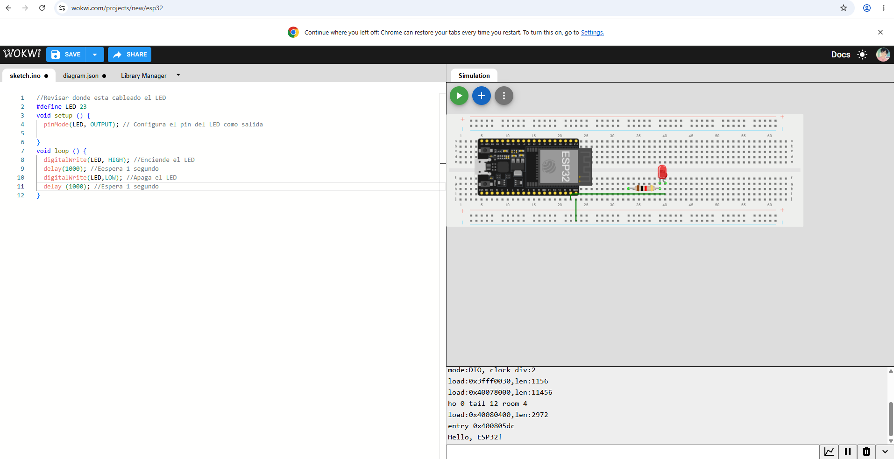
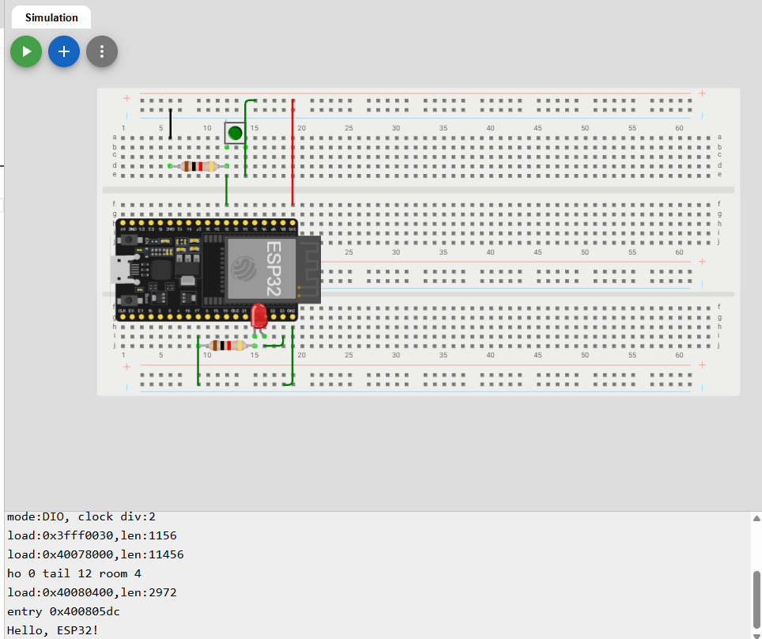
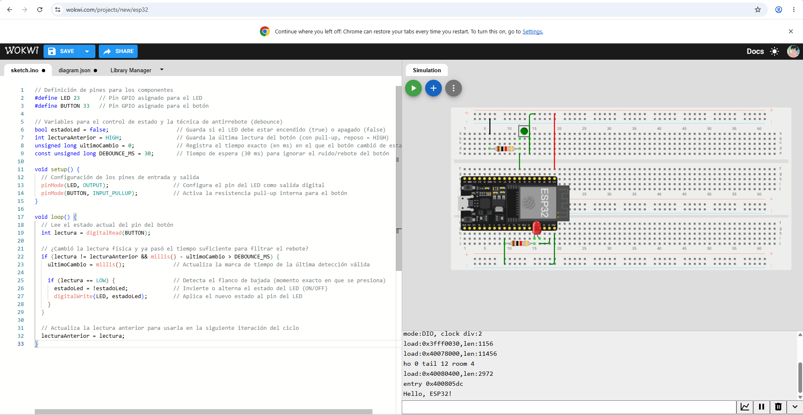

# Sesión — Entrada, Salida y Antirrebote con ESP32

## Objetivos
- Configurar pines digitales como entrada (con resistencia pull-up/pull-down) y salida en el microcontrolador ESP32.
- Comprender el fenómeno físico del rebote mecánico en un botón o pulsador (bouncing).
- Implementar una rutina de filtrado antirrebote por software para obtener lecturas estables en el sistema.

## Materiales
- (1×) Módulo ESP32 (NodeMCU 32S o similar)
- (1×) Pulsador (Botón táctil)
- (1×) Resistencia de 10 kΩ (en caso de no utilizar la resistencia pull-up interna del ESP32)
- (1×) LED indicador
- (1×) Resistencia de 220 Ω (para el LED)
- Protoboard y cables de conexión

## Desarrollo

**Explicación del fenómeno de rebote:** Cuando se presiona un botón mecánico, los contactos metálicos internos chocan y vibran microscópicamente durante unos milisegundos antes de asentarse. Esto provoca que el ESP32 detecte múltiples pulsos falsos (altos y bajos rápidos) en lugar de una sola pulsación limpia. Para solucionar esto, implementamos un control por software basado en tiempo (`millis()`) que filtra estas fluctuaciones.

### Código fuente (Arduino IDE)

```cpp
const int botonPin = 15;    // Pin digital conectado al botón (Entrada)
const int ledPin = 2;       // Pin digital conectado al LED (Salida)

// Variables para el control del estado y el antirrebote
int estadoLed = LOW;         // Estado actual del LED
int estadoPulsador;          // Lectura actual del pin del botón
int ultimoEstadoPulsador = HIGH; // Lectura anterior del botón (asumiendo Pull-Up)

unsigned long ultimoTiempoDebounce = 0;  // Último momento en que el botón cambió de estado
unsigned long delayDebounce = 50;        // Tiempo de retardo para el antirrebote (en milisegundos)

void setup() {
  pinMode(ledPin, OUTPUT);
  pinMode(botonPin, INPUT_PULLUP); // Activamos resistencia pull-up interna
  digitalWrite(ledPin, estadoLed);
}

void loop() {
  int lectura = digitalRead(botonPin);

  // Si el estado del botón cambió debido a ruido o presión:
  if (lectura != ultimoEstadoPulsador) {
    ultimoTiempoDebounce = millis(); // Reiniciamos el temporizador de rebote
  }

  // Si ha pasado el tiempo suficiente, tomamos la lectura como válida
  if ((millis() - ultimoTiempoDebounce) > delayDebounce) {
    
    // Si el estado del botón realmente cambió:
    if (lectura != estadoPulsador) {
      estadoPulsador = lectura;

      // Si el botón está presionado (LOW en INPUT_PULLUP), cambiamos el estado del LED
      if (estadoPulsador == LOW) {
        estadoLed = !estadoLed;
        digitalWrite(ledPin, estadoLed);
      }
    }
  }

  ultimoEstadoPulsador = lectura;
}

```
## Imágenes y esquemáticos
### 1. BLINK
   
*Programa 1: BLINK realizado en Wokwi.*
### 2. BLINK con botón
   
*Programa 2: BLINK con botón realizado en Wokwi*
### 3. TOGGLE con antirrebote
   
*Programa 3: TOGGLE con antirrebote realizado en Wokwi.*

## Fallas y Soluciones

- **Síntoma:** Al intentar subir el código a la ESP32, aparecía un error indicando que el puerto estaba ocupado o no existía. El cable USB actuaba simplemente como un cargador, pero no transmitía datos.
- **Cómo lo encontré:** Revisamos el Administrador de Dispositivos en la computadora dentro de la sección de puertos COM y LPT. Notamos que no detectaba ninguna placa conectada por USB y únicamente aparecían los puertos del Bluetooth.
- **Solución:** Identificamos el chip de la tarjeta ESP32 el cual es el CP2102 e instalamos su driver correspondiente en la laptop. Tras la instalación, la computadora reconoció el puerto bajo el nombre *Silicon Labs CP210x USB to UART Bridge*, logrando así que los datos se transmitieran correctamente a la tarjeta.

## Aprendizajes
En esta práctica aprendimos la importancia de configurar correctamente los controladores de comunicación entre la computadora y la tarjeta ESP32 antes de intentar subir cualquier código. También comprendimos cómo funciona la lógica de programación para salidas digitales, cómo manejar entradas con el modo `INPUT_PULLUP` y cómo solucionar los problemas de rebote en botones tanto por hardware como por software.

## Siguiente paso
Para las siguientes prácticas buscamos aprender más sobre programación para poder hacer sistemas un poco más complejos, entender bien su funcionamiento y lograr armarlos correctamente antes de ponerlos en práctica.
